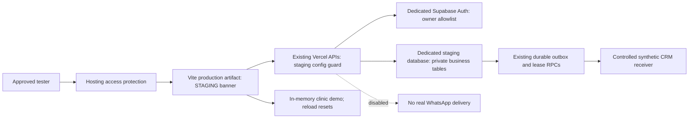

# Protected staging architecture

> Later authorized execution: [current protected staging and acceptance evidence](../staging-execution/README.md). This report retains the earlier preparation findings.

Prepared locally; no hosting, project, account or database was provisioned or changed.

Keep the current React/Vite app and Vercel API model. Use a separate Supabase project and a separate protected Preview deployment/environment. Do not upload the static Sites artifact expecting working business APIs. `vercel.staging.json` is a prepared alternative config, not a change to the existing production deployment. It omits cron and adds all-path noindex/nosniff/frame/referrer headers. Hosting protection is an owner-side control; noindex is not authentication. Verify HTML, assets and `/api/*` are protected before sharing a preview. Current [Vercel deployment-protection documentation](https://vercel.com/docs/deployment-protection) describes available mechanisms; confirm plan availability without purchasing anything automatically.

`server/environment.ts` refuses preview API use without explicit staging identity, equal/mismatched staging and protected-existing project references, production deployment target, mismatched CRM origins, missing server config and enabled WhatsApp. Staging APIs also validate request origin. This checks declared configuration, not actual resource ownership or credential provenance. The owner must privately verify identities before setting them; inventing a reference to satisfy a check is prohibited.

`api/environment.ts` exposes only the environment label and in-memory demo boundary. `VITE_APP_ENV=staging` shows an EN/FR environment banner. Neither establishes host protection. Production behavior is otherwise preserved; no clinical backend, multi-tenant system or patient storage was introduced.

The local receiver module binds loopback only and accepts synthetic center names. Its failure controls are in-process, never public HTTP. It is QA infrastructure with an in-memory receipt map, not a durable CRM implementation. A hosted sandbox/test receiver requires a separately reviewed, authorized owner-controlled deployment with persistent idempotency receipts and the documented receipt-query contract.
